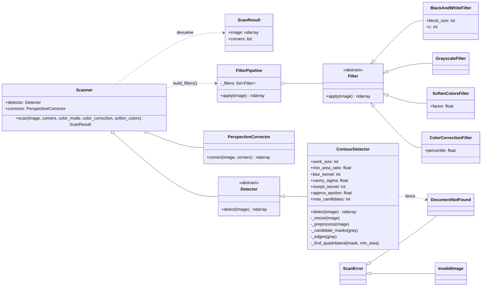

# TP 2 — Escáner de documentos


## Integrantes

| Integrantes | 
**Natalia Nodar**
**Nicolas Gold**
**Ikemiya Facundo** 
**Betsabe Mayra Aldana** 

---

## Instalación

Requisitos: **Python 3.10 o superior**.

```bash
cd backend
python -m venv .venv
```

Activar el entorno virtual:

```bash
# Windows (PowerShell)
.venv\Scripts\activate

# Linux / macOS
source .venv/bin/activate
```

Instalar las dependencias:

```bash
pip install -r requirements.txt
```

## Correr la aplicación

```bash
cd backend
uvicorn app.main:app --reload --port 8765
```

- Frontend: <http://localhost:8765>
- Documentación interactiva de la API: <http://localhost:8765/docs>

Los escaneos se guardan en `backend/storage/`, carpeta que no se sube al repositorio.

## Usar la línea de comandos

Desde `backend/`, con el entorno virtual activado:

```bash
python -m docscan ENTRADA SALIDA [--color-mode {color,grayscale,bw}] [--no-color-correction] [--soften-colors X]
```

| Opción | Valores | Por defecto | Qué hace |
|---|---|---|---|
| `--color-mode` | `color`, `grayscale`, `bw` | `color` | Modo de color del resultado |
| `--no-color-correction` | — | corrección activada | Desactiva la corrección de la dominante de color |
| `--soften-colors` | `0` a `1` | `0` | Aclara los colores muy saturados (resaltadores, sellos) |

Ejemplos:

```bash
python -m docscan foto.jpg escaneo.png
python -m docscan foto.jpg escaneo.png --color-mode grayscale --soften-colors 0.5
python -m docscan foto.jpg escaneo.png --color-mode bw --no-color-correction
```

Si no se reconoce el documento, el motivo se muestra por `stderr`, no se crea el archivo de salida
y el programa termina con código distinto de 0.

## Correr los tests

```bash
cd backend
pytest -v
```

Estado actual: **92 tests pasan**.

| Archivo | Qué prueba |
|---|---|
| `tests/test_contract.py` | Tests de aceptación dados por la cátedra (79 casos) |
| `tests/test_detection.py` | Orden de las esquinas del detector |
| `tests/test_perspective.py` | Tamaño del rectángulo resultante de la corrección de perspectiva |
| `tests/test_filters.py` | Cada filtro sobre imágenes chicas creadas en memoria, y el pipeline completo |
| `tests/test_storage.py` | Guardar, obtener, listar y borrar escaneos en una carpeta temporal |

---

## Diagrama de clases del core



Fuera del core, en la API, `ScanRepository` (`app/repository.py`) guarda y lee los escaneos, y
los routers solo coordinan: `read_upload` → `Scanner.scan` → `ScanRepository.save`. El paquete
`docscan` no importa nada de FastAPI ni de `app`, así que se puede usar igual desde la API, desde
la CLI o desde cualquier otro programa.

---

## Decisiones de diseño y de procesamiento

### Flujo general

```
foto ─► read_photo (EXIF) ─► ContourDetector ─► PerspectiveCorrector ─► FilterPipeline ─► PNG
                                  │
                                  └─► DocumentNotFound (si no hay documento)
```

### Responsabilidades separadas

Detectar, enderezar y mejorar viven en clases distintas. `Scanner` recibe el detector y el
corrector por constructor (inyección de dependencias), con valores por defecto. Para cambiar el
algoritmo de detección alcanza con pasar otra subclase de `Detector`, sin tocar el escáner. Por la
misma razón, `/api/detect` usa el detector solo, sin pasar por el escáner.

### Cómo detectamos el documento

`ContourDetector` busca **un cuadrilátero convexo que ocupe al menos el 15 % de la foto**:

1. **Copia reducida** a 600 px de lado mayor, con `INTER_AREA` (la interpolación adecuada para
   achicar). Nunca se agranda. Al final, las esquinas se reescalan al tamaño original.
2. **Escala de grises + `GaussianBlur` 5×5**: un filtro pasa bajos que elimina el ruido antes de
   buscar bordes.
3. **Auto-Canny**: los umbrales se calculan a partir de la mediana del brillo,
   `(1 − σ)·mediana` y `(1 + σ)·mediana` con σ = 0.33. Con umbrales fijos, una foto oscura casi no
   da bordes y una muy clara da demasiados; con la mediana se adaptan a cada foto.
4. **Cierre morfológico** (`MORPH_CLOSE` con un elemento elíptico 5×5): une los bordes cortados
   para que el contorno de la hoja quede cerrado.
5. **Contornos externos** (`RETR_EXTERNAL`), ordenados por área. El texto y las imágenes de
   adentro de la hoja no compiten con su borde.
6. **`approxPolyDP`** con ε = 2 % del perímetro. Se acepta el primer contorno con **4 vértices,
   convexo y con área ≥ 15 %**. Así se descartan un círculo (da muchos vértices), un documento
   demasiado chico y una foto sin bordes.
7. **Orden de las esquinas**: la superior izquierda tiene la menor suma `x + y`, la inferior
   derecha la mayor, y la diferencia `y − x` separa la superior derecha (menor) de la inferior
   izquierda (mayor).

Si nada cumple las condiciones, se lanza `DocumentNotFound` con un mensaje que explica cómo sacar
una mejor foto. Nunca se devuelve "cualquier cosa": un resultado equivocado es peor que un aviso
claro.

Los parámetros (tamaño de trabajo, área mínima, kernels, σ, ε) son atributos con valores por
defecto, no números mágicos. `_candidate_masks` es un generador, así que se puede agregar otra
estrategia (por ejemplo, una máscara de Otsu) con un `yield` más, sin tocar el resto.

**Limitación conocida:** el orden por suma y diferencia es ambiguo cerca de los 45° de rotación.
Con fotos normales de documentos, la rotación es bastante menor.

### Corrección de perspectiva

`PerspectiveCorrector` calcula el ancho y el alto del resultado como el máximo de cada par de
lados opuestos, para no perder resolución. Después arma la homografía con
`cv2.getPerspectiveTransform` y la aplica con `cv2.warpPerspective`. Como las esquinas llegan
ordenadas (TL, TR, BR, BL), el documento queda derecho, sin espejar y recortado.

### Cómo corregimos el color

`ColorCorrectionFilter` estira **cada canal B, G y R por separado** para que su percentil 99 llegue
a 255. El papel es lo más claro de la foto: si tiene una dominante amarilla (el azul más bajo), al
llevar cada canal a 255 se neutraliza el tinte y el papel queda blanco. Usamos el percentil 99 y no
el máximo para que unos pocos píxeles de brillo o reflejo no arruinen la escala.

### Las otras mejoras

- **Aclarado de colores fuertes** (`SoftenColorsFilter`): en HSV, cada píxel se interpola hacia el
  blanco con un peso `s · v³ · factor`. Con saturación 0 (negro, blanco, grises) el peso es 0 y no
  cambia nada. Con `v³`, las tintas oscuras casi no se tocan y los resaltadores y sellos luminosos
  sí. Es gradual: a mayor factor, más se aclaran, y con 0 la imagen no cambia.
- **Escala de grises** (`GrayscaleFilter`): `cvtColor` a un solo canal.
- **Blanco y negro** (`BlackAndWhiteFilter`): **umbral adaptativo gaussiano** (bloque 21, C = 10)
  en lugar de un umbral fijo. El umbral se calcula localmente, así que funciona aunque la foto tenga
  sombras o luz despareja.

El orden es: corrección de color → aclarado → modo de color. La corrección va primero porque
necesita los tres canales, que se pierden al pasar a grises.

### Cómo evitamos los `if/elif`

Todas las mejoras heredan de la clase abstracta `Filter` y exponen `apply(image) → image`.
`FilterPipeline` recorre la lista y llama a `apply` en cada una, **sin saber qué filtro es**:

```python
for f in self._filters:
    result = f.apply(result)
```

La decisión de qué filtros usar se toma **una sola vez**, al armar la lista en `build_filters()`
según las opciones, y no dentro del bucle que los aplica. Para agregar un filtro nuevo (sepia,
eliminación de sombras, etc.) alcanza con crear otra subclase de `Filter` y sumarla a
`build_filters()`. Los filtros existentes no se tocan.

### Excepciones de dominio

El core solo lanza `ScanError` y sus subclases (`InvalidImage`, `DocumentNotFound`) y no sabe nada
de HTTP. La API las traduce en un solo lugar (`app/errors.py`): `DocumentNotFound` →
`422 DOCUMENT_NOT_FOUND`. Por eso los endpoints no tienen `try/except`. La CLI las muestra por
`stderr` y termina con código distinto de 0.

### Almacenamiento

`ScanRepository` encapsula todo el acceso a disco (`save`, `get`, `list` y `delete`), así que
cambiar el disco por una base de datos o por S3 solo afectaría a esa clase. Cada escaneo son tres
archivos en `config.STORAGE_DIR`:

| Archivo | Contenido |
|---|---|
| `{id}.png` | El escaneo |
| `{id}-original.{ext}` | La foto tal como se recibió |
| `{id}.json` | Los metadatos que devuelve la API |

- El `id` es un `uuid4` y los nombres de archivo se generan, nunca se usa el nombre que mandó el
  usuario.
- Los ids se validan con una expresión regular para evitar *path traversal* (`../`).
- Como todo queda en disco, los escaneos sobreviven a un reinicio del servidor.

---